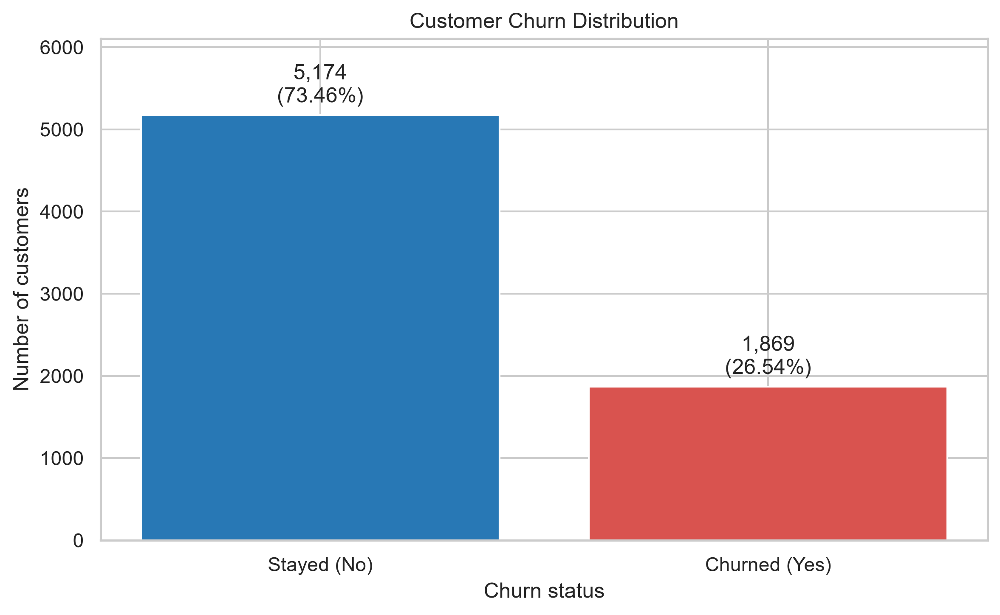
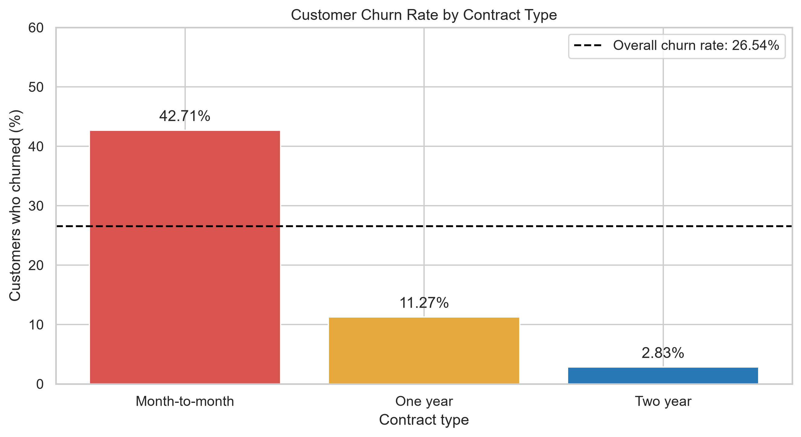
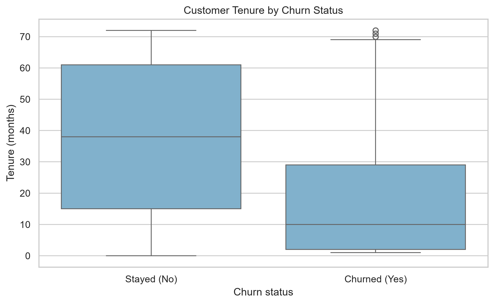
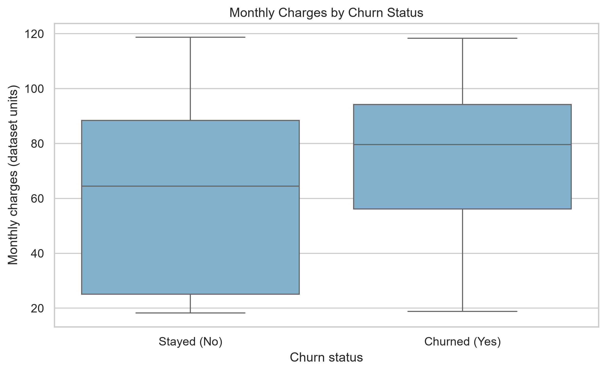
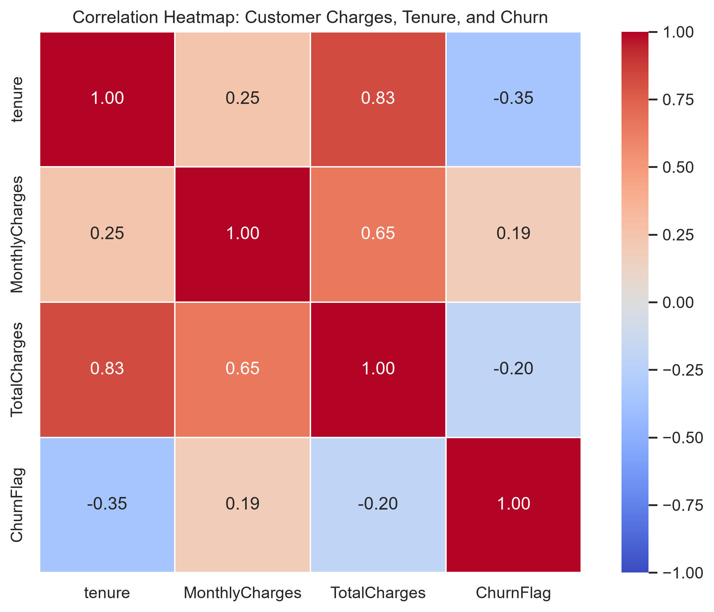

# Customer Churn Analysis & Exploration

An exploratory data analysis project completed for the CodeNova
AI/ML Internship, Batch 02.

## Objective

Explore customer characteristics associated with churn, focusing
on contract type, tenure, monthly charges, and total charges.

This project examines statistical associations. It does not train
a predictive model or establish causal relationships.

## Dataset

- Dataset: IBM Telco Customer Churn
- Source: https://www.kaggle.com/datasets/blastchar/telco-customer-churn
- Original CSV: WA_Fn-UseC_-Telco-Customer-Churn.csv
- Customers: 7,043
- Columns: 21
- Churn labels: Yes and No

The dataset is provided by its original source, not created by
this project. Refer to the source page for its usage terms.

## Tools

- Python
- Pandas
- NumPy
- Matplotlib
- Seaborn
- Jupyter Notebook
- Visual Studio Code

## Analysis Workflow

1. Load and inspect the dataset.
2. Check data types, missing values, blank strings, and duplicates.
3. Convert TotalCharges from text to numeric.
4. Analyze the overall churn distribution.
5. Compare churn rates across contract categories.
6. Compare tenure and monthly charges by churn status.
7. Create a numeric correlation heatmap.
8. Export visualization images and summary tables.
9. Document findings, suggested experiments, and limitations.

## Data Quality and Cleaning

- No duplicate rows were found.
- No duplicate customer IDs were found.
- TotalCharges originally contained 11 blank text entries.
- These entries were converted to recognized missing values.
- All 7,043 customers were retained.
- No missing charges were replaced with assumed values.
- Correlations involving TotalCharges exclude missing values
  separately for each pair of variables.

## Key Findings

| Measure | Result |
|---|---|
| Overall churn | 26.54% — 1,869 of 7,043 customers |
| Month-to-month contract churn | 42.71% |
| One-year contract churn | 11.27% |
| Two-year contract churn | 2.83% |
| Median tenure — stayed | 38 months |
| Median tenure — churned | 10 months |
| Mean monthly charges — stayed | 61.27 |
| Mean monthly charges — churned | 74.44 |

### Correlations with Churn

Churn is encoded as 0 for stayed and 1 for churned.

| Feature | Correlation |
|---|---:|
| Tenure | -0.352 |
| Monthly charges | 0.193 |
| Total charges | -0.199 |

Tenure has the largest absolute correlation with churn among
these three numeric features.

## Suggested Retention Experiments

- Test improved onboarding and early support check-ins.
- Investigate service and billing concerns among month-to-month customers.
- Test voluntary longer-term plan incentives.
- Review plan suitability and perceived value for customers
  with higher monthly charges.

These are proposals to investigate, not interventions proven
effective by this analysis.

## Visualizations

### Overall Churn Distribution



### Churn Rate by Contract Type



### Tenure by Churn Status



### Monthly Charges by Churn Status



### Correlation Heatmap



## Project Structure

```text
codenova-customer-churn-analysis/
├── data/
│   └── WA_Fn-UseC_-Telco-Customer-Churn.csv
├── notebooks/
│   └── churn_analysis.ipynb
├── reports/
│   ├── figures/
│   └── tables/
├── README.md
├── requirements.txt
└── .gitignore
```

## How to Run on Windows

1. Download or clone this repository.
2. Install Python. Development used Python 3.12.10.
3. Open a terminal in the project folder.
4. Create a virtual environment:

```powershell
py -m venv .venv
```

5. Install dependencies:

```powershell
.\.venv\Scripts\python.exe -m pip install -r requirements.txt
```

6. Obtain the CSV from the dataset source and place it inside
   the data folder using the original filename.
7. Open notebooks/churn_analysis.ipynb in VS Code.
8. Select the project's .venv Python environment as the notebook kernel.
9. Run all notebook cells in order.

The notebook exports charts to reports/figures and summary
tables to reports/tables.

## Limitations

- Findings are observational, not causal.
- Comparisons do not control for differences between groups.
- TotalCharges contains 11 missing values.
- Numeric correlations describe linear associations.
- Findings may not generalize to other companies or time periods.